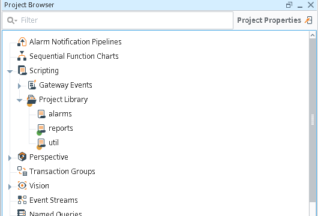
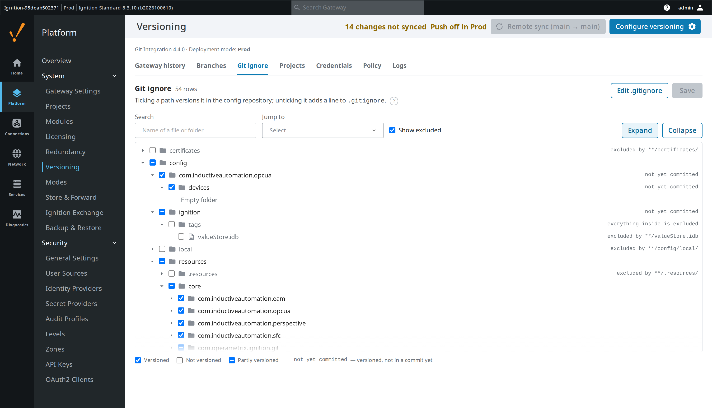
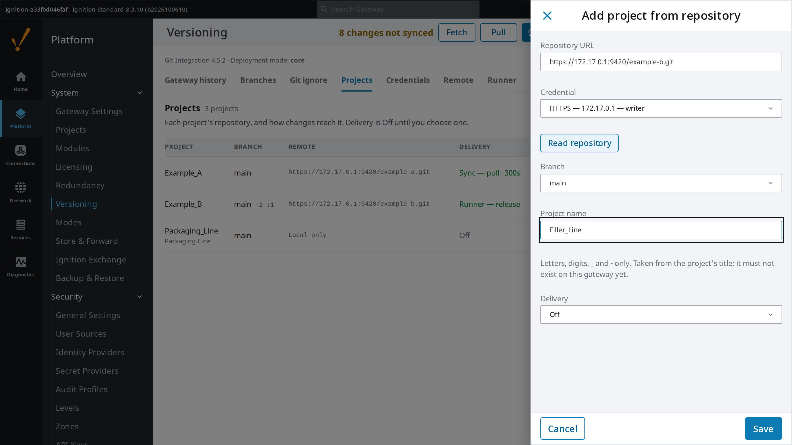
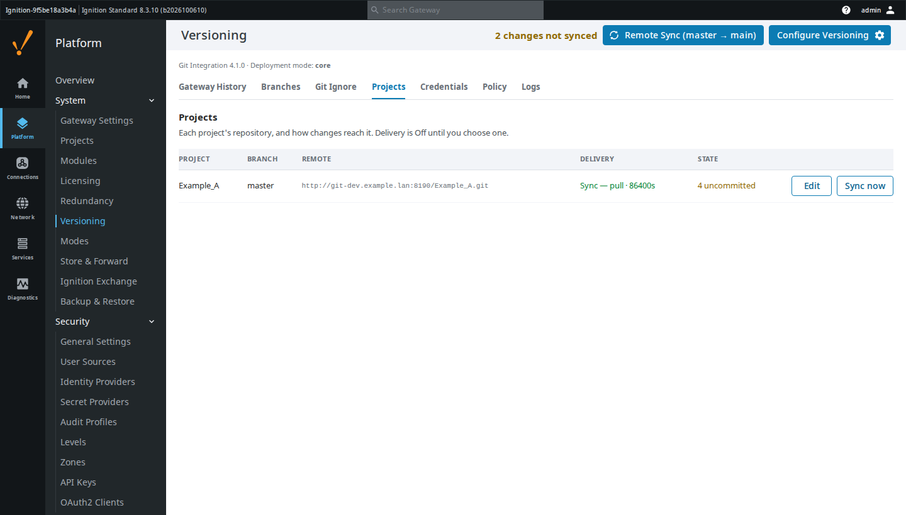
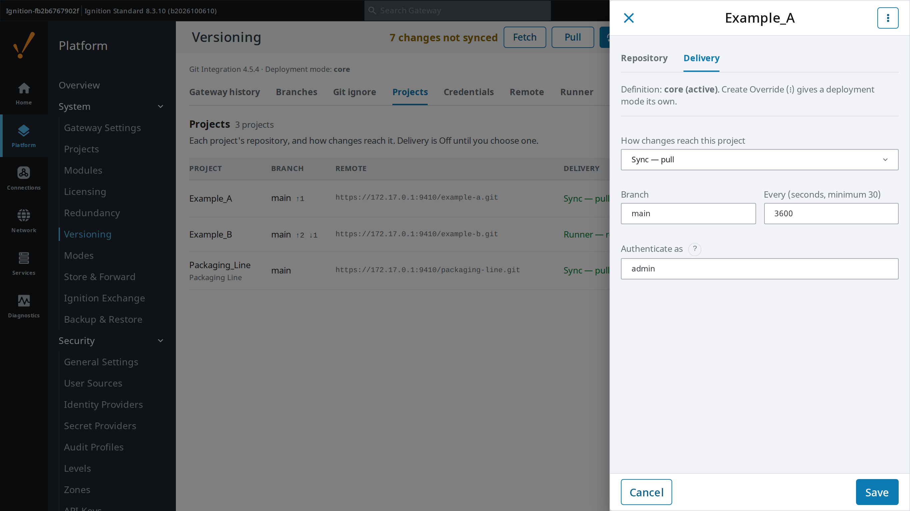
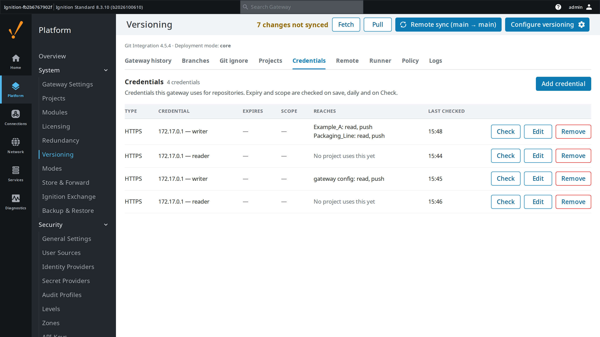
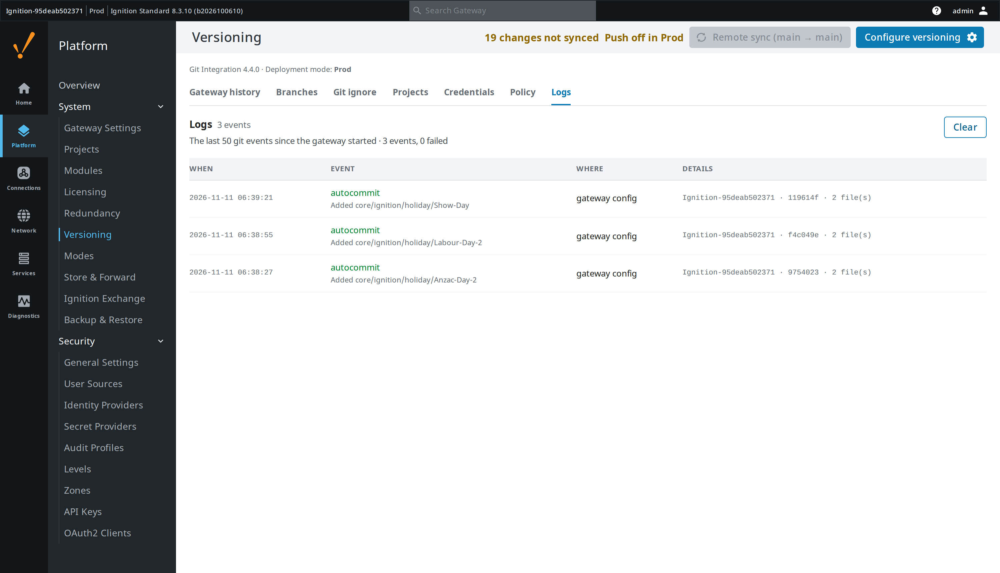
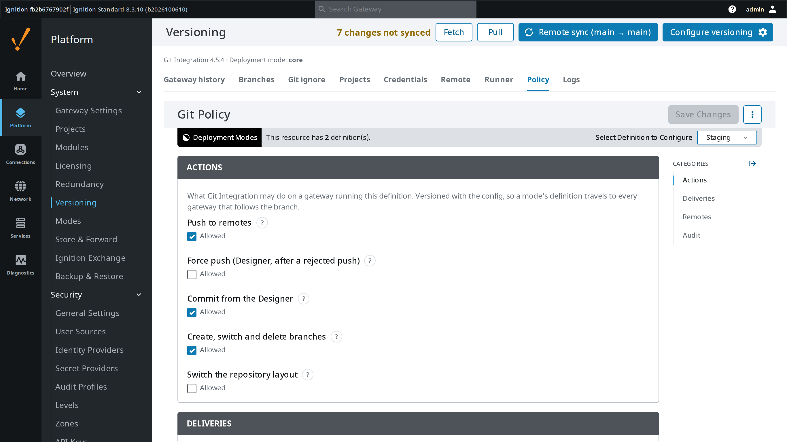
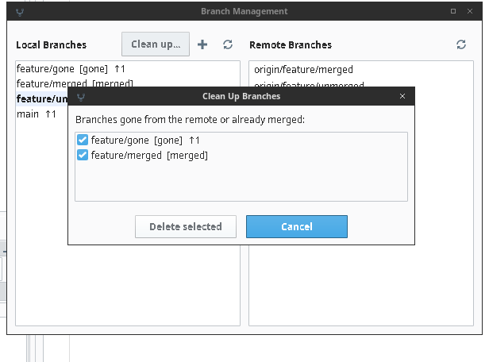

# Git Integration

Version control for Ignition 8.3 — project resources from the Designer, gateway
configuration from the gateway. A Gaskony build of
[OperaMetrix's Git module](https://github.com/operametrix/ignition-git-module),
under the Beerware licence.

> **Not an Inductive Automation product, and not supported by Inductive Automation.** Independent work, largely built with AI tools and tested for one purpose on a limited subset of gateway versions and platforms. Take the ideas; fork and review it before it goes near production. Feedback is welcome in Issues; improvements are made where possible, but no support is guaranteed. [NOTICE.md](NOTICE.md) says more.

## Why this exists

Two people editing the same gateway is two people overwriting each other, and a
gateway backup is a snapshot, not a history: it cannot tell you what changed
between Tuesday and Friday or who changed it. Ignition has no built-in answer,
so the answer is the one every other trade already uses — put it in git.

Upstream covers the Designer half well. This build adds what was missing in
practice: seeing at a glance which resources you have not committed, controlling
what the gateway-config repository versions (so a repo never fills with SQLite
databases and log files), and answering from the gateway which projects are in
git at all. A release or a branch can also come down onto the gateway on a
schedule, or the moment it is published, without anyone opening a Designer.

## What it looks like

Uncommitted work is marked in the Project Browser. Green is new, amber is
changed, and a folder carries the state of what is inside it — red if something
under it was deleted, since a deleted resource has no tree node of its own.

The gateway's Versioning page decides what config-as-code covers. The **Git
ignore** tree shows the whole data directory: a ticked row is versioned, an
unticked one is greyed and says why on the right (its own `.gitignore` line, an
inherited rule, or its parent folder). By default only `config/` is versioned.
The tree has a search, a jump to any top-level folder, a filter that hides
everything excluded, and Expand/Collapse.

The **Projects** tab lists every project on the gateway, unversioned ones
included, and how changes reach each one. **Edit** opens a drawer with the
project's repository and delivery; **Branches** opens its commit graph. **Add
from repository** brings in a project this gateway does not have yet: it reads
the repository's branches and the project's title, clones the branch into a new
project and loads it (Separate layout).

**Credentials** shows, for each repository credential, when its token expires,
what it is allowed to touch, and which projects it can read or push. The host is
asked on save, daily and on **Check**, since a token carries none of it. A
classic token reaches every repository its account can, and is flagged for it.
GitHub will not report a fine-grained token's grants, so that row says so rather
than guessing. A project whose credential has expired, is refused, or cannot
read its remote says so on the Projects tab, as does one expiring within 14
days.

**Logs** lists every commit, push, pull, sync, checkout and release since the
gateway started, with the user, including an unattended one that failed, and why.

## What it does

**In the Designer** — clone or initialise a project repository, manage remotes
and credentials, commit from a dockable panel with per-resource selection, amend
the last commit, browse history and diffs, switch and clean up branches, and
push or pull.

**On the gateway** — versions the data directory as code, commits automatically
when a config resource changes, shows history and per-commit diffs, restores a
previous commit, and pushes to a remote. **Git ignore** edits `.gitignore`
directly: unticking a tracked path also untracks it, and rules you wrote by hand
are never rewritten.

**Repository layout** — one repository per project (default), or the whole
gateway as one repository. Switch under **Versioning → Configure versioning →
Repository layout**. [docs/LAYOUT.md](docs/LAYOUT.md) has the differences,
branch handling and what a switch does.

**Delivery** — each project has one, chosen on the Projects tab. It only brings
changes in; nothing is pushed.

| Delivery | What happens |
| --- | --- |
| Off (default) | Nothing. A runner delivery for it is refused. |
| Runner — release | A GitHub workflow uploads a release zip; the project is replaced by it, keeping its git repository and project properties, with no restart. |
| Runner — repo updates | A workflow asks the gateway to pull the branch. |
| Sync — pull | The gateway fetches on a timer and fast-forwards; refused while anyone has local changes. |
| Sync — replace | The gateway fetches on a timer and makes the project match the branch exactly, rollbacks included. |

Release and replace keep the gateway's own project properties (identity provider, default
database) unless **Keep this gateway's project properties** is unticked for that project.

Runner deliveries need the **Runner** tab's *Accept deliveries from a runner* on and a token.
Repo updates and sync need a remote and a credential.

**Deployment modes** — on an 8.3 gateway running in a mode (Dev, Prod), the
**Policy** tab sets what the module may do there: push, Designer commits,
branch and layout switches, which deliveries, which remote hosts. The Policy, Remote and
Runner tabs are the gateway's own settings page, so a mode gets its own definition from the ⋮
menu's Create Override, Move Definition and Remove Override, as anywhere else on the gateway;
project deliveries and credentials have the same menu. Only the policy is
versioned, so a Prod override written on Dev travels with the branch. For a
stricter site, **Only deliver commits merged on GitHub** makes every delivery
refuse a branch tip that GitHub did not sign (a pull request merged on GitHub).
Pushes, pulls, deliveries, branch and layout switches, restores, reverts, remote, policy,
credential and override changes each write one row to the gateway's audit profile, from the
gateway page or a Designer (with the Designer's host).
[docs/MODES.md](docs/MODES.md) has the setup.

This build adds the gateway-side Versioning page, change badges, branches and
delivery on top of upstream 2.1.0 ([CHANGELOG.md](CHANGELOG.md)). The
Versioning page meets WCAG 2.1 AA, short of three platform controls with no
naming prop of their own: the gateway's header logo, the History table's
page-size selector and row-expand button, and the raw `.gitignore` editor's
resize handle.

## How to use it

Install the signed `.modl` from the latest release through **Config → Modules →
Install or Upgrade Module**, then restart the gateway.

- **Project versioning:** open a project, click **Configure** in the Designer's
  status bar, and either clone a remote or initialise locally. Commit from the
  **Commit** tab beside the Project Browser.
- **Branches:** the **Branch** button opens local and remote lists; **Clean up…**
  offers every gone or merged branch.

  

- **Gateway config:** **Platform → System → Versioning → Initialize versioning**.
  Adjust what is covered under **Git ignore**.
- **Delivery:** **Versioning → Projects → Edit**, choose the delivery, Save. The
  project must exist on the gateway first; for its first release, create it
  empty under **Platform → Projects**.

For a runner (push) delivery, set up the token, runner and workflow as in
[docs/AUTOMATION.md](docs/AUTOMATION.md). A runner can build, gate and report
back to GitHub, and a release needs no git credentials on the gateway. Sync
(pull) needs no machine beside the gateway, but the gateway needs a credential
and a route to the git host, and nobody learns whether it was applied — check
Logs.

Remotes are HTTPS or SSH, with TLS certificates checked; for a private CA,
local test remotes and a production checklist see [docs/MODES.md](docs/MODES.md)
and [docs/TROUBLESHOOTING.md](docs/TROUBLESHOOTING.md).

To build from source, copy `gradle.template.properties` to `gradle.properties`,
fill in the keystore details, then run `./gradlew build` for the signed
`build/GitIntegration.modl`. The version lives in `version.properties` only.

## Licence

Beerware (Revision 42) — see [LICENSE.md](LICENSE.md) and `license.html`. The
original notice is retained; this build is modified and distributed by Gaskony.
