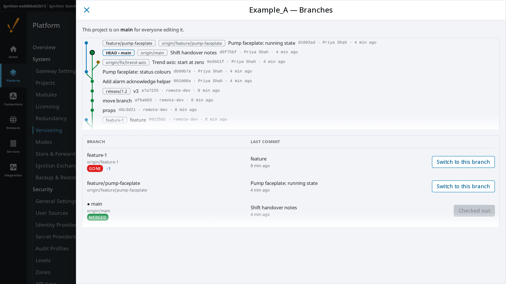
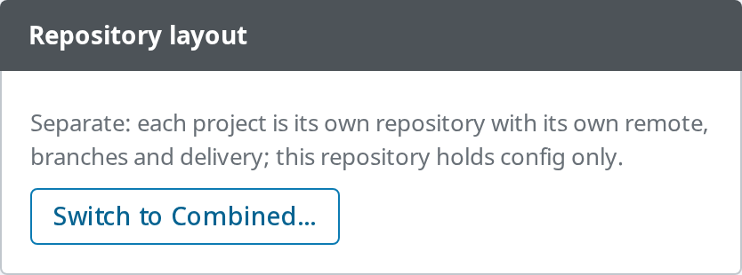
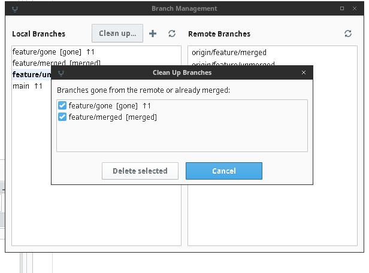

# Repository layout and branches

Some teams want each project in its own repository; others want the whole
gateway — config and every project — as one repository they can read, review
and branch as a unit. A gateway setting picks one, and an admin can switch
either way at any time.

| | Separate (default) | Combined |
| --- | --- | --- |
| Repositories | One per project at `projects/<name>`, plus the config repository at the data directory | One at the data directory, holding `config/` and `projects/` |
| Designer commit, diff, history, revert, badges | That project's repository | Limited to `projects/<name>/`; a commit never takes config or another project with it |
| Branches, checkout, pull, push, fetch | Per project | Gateway-wide: checking out a branch switches config and every project, then reloads them |
| Remote and credential | Per project, in the Designer's Remotes popup | One, set on the Remote tab; the Designer shows it read-only |
| Delivery | Per project on the Projects tab | Pulls set once in Configure versioning › Delivery (Sync — pull, Sync — replace, Runner — repo updates); a project keeps Off or Runner — release |

**Branches.** One gateway has one checked-out branch per project (Combined: one for
everything), shared by everyone editing it, so the gateway page shows it. The
Projects tab has a Branch column with ↑/↓ against the upstream and a
**Branches** button on each versioned project's row; the Versioning page has a
**Branches** tab for the gateway config. With no remote set, the view says so and
links to where it is set. Each draws the commit graph beside the branch list,
with gone, merged, ahead and behind marked. In Combined the project view shows
the gateway repository and dims commits that leave that project. **Switch to
this branch** changes it from the page; it is refused, with the files, while
there is uncommitted work or while a sync or delivery follows another branch.



In Combined, a Designer checkout of a branch or commit moves config and every
project, so it is refused, naming the files, while anything in the repository is
uncommitted — config, another project, or this one (its changes cannot be put
aside per branch, as they are in Separate). Files Ignition only reformatted do
not count. A Designer pull, checkout, revert or merge abort is refused while that
Designer has unsaved edits, listing them: save first, then try again.

A pull that stops on a conflict leaves the merge open for the Designer's conflict
dialog. While it is open the gateway makes no config commits (the auto-commit
retries every 30 seconds), and page pulls, branch switches, restores, the layout
switch and Join remote history are refused. A Designer that pulls or checks out
while one is open offers the conflict dialog again; the Versioning header shows
**Merge in progress** with **Abort merge…**, which puts back only the files the
merge changed.

**Any Designer user moves the whole gateway in Combined.** Pull, checkout, push and
force push from a Designer act on the gateway repository with the gateway's
credential, for config and every project. On a gateway where that matters, turn
off **Create, switch and delete branches** and **Force push** (and Push, if
Designers should not push) in a Prod policy override ([MODES.md](MODES.md)).

In Combined, a revert from the Designer is refused when the commit also changed
files outside that project, rather than undoing config or another project's
work from a window that cannot show it. Config's auto-commit and **Restore**
leave `projects/` alone. A runner release and a deleted project are each
committed for that project's folder only. An open Designer follows a layout or
branch switch within ten seconds, without reopening.



To switch: **Versioning → Configure versioning → Repository layout**. It is
refused, with nothing changed, while any project has uncommitted work.

- **Separate → Combined** moves each project's `.git` to
  `var/git-archive/<name>-<time>.git` (kept, so its history and remotes can come
  back), adds `projects/` to the gateway repository's `.gitignore` rules, and
  commits every project in one commit. History is not merged in. The config
  rules (`db/`, `logs`, `*.log`…) are scoped to `config/` so they never drop a
  project's files, and rules you add under `projects/` on the Git ignore tab
  apply. Each project's `global-props/data.bin` (per-gateway project properties)
  is left out by an ordinary line: tick it on the Git ignore tab to share it.
  A Combined repository from before 4.4.0 has its rules updated this way once
  at start-up, in one commit.
- **Combined → Separate** gives each project its own repository again — its
  archived one if you tick *Restore each project's earlier history* and one
  exists, with one commit for what changed meanwhile; otherwise a new repository
  with one commit of its current files — and takes `projects/` back out of the
  gateway repository. It is refused, naming the folder, when a project folder
  is a link or mount leading outside the data directory, or sits inside another
  git work tree: a new `.git` there would land in someone else's checkout. A
  `projects/<name>/.git` left from before blocks the switch until you tick
  *Archive leftover .git folders*, which moves it to `var/git-archive`.

Per-project credentials and deliveries are kept while Combined. A project's
remotes live in its own `.git`, so they come back only with *Restore each
project's earlier history*; without it the new repository has no remote, and the
switch warns when a Sync delivery is still on for such a project (it would fail on
every interval until a remote is added in the Designer or the delivery is set to
Off). The archive also keeps what was only in the old repository: its stashes
(per-branch uncommitted work) and commits never pushed. The gateway's Pull and
Runner deliveries stop while Separate.

## Using an existing repository

The module does not remap folders: the gateway repository has `config/` at the
top and, in Combined, `projects/<name>/`. A repository laid out another way —
say `gateway/config/` and `project/` — is refused before anything is pushed to
it or pulled from it, as is a branch whose history is unrelated to the
gateway's. Restructure it once, on your side:

```text
git mv gateway/config config
git mv project projects/<ProjectName>
git commit -m "Gateway repository layout"
git push
```

Then bring the two histories together once. Every gateway's repository starts
with its own first commit, so a remote branch another gateway created shares no
history with this one: after **Fetch**, the page offers **Join remote history**.
It moves this gateway's branch onto the remote's latest commit, keeping every file
on the gateway as it is, and commits the differences as one commit ("This
gateway's config on top of origin/main"). Push and Pull work from then on. It
is refused when the remote's layout does not match, and needs the policy's
branch changes.

**Fetch** and **Pull** sit beside Remote sync: Fetch updates how far the remote
is ahead, Pull merges it in (fast-forward or merge), refused with the file list
while anything is uncommitted and when the policy does not allow Sync — pull.

**Delete versioning** keeps the saved remote and its credential unless you tick
*Also remove the saved remote*, so initialising again reconnects (Update from
remote, or a new repository and Join remote history).

New repositories start on the configured remote branch (default `main`). One
made before 4.2.0 may sit on `master` while the remote's branch is `main`; the
Versioning header (or the project's Branch column) then offers **Rename local
master to main** — same commits, upstream kept.

## Designer branch list

The **Branch** button opens local and remote lists. A fetch drops remote
branches that were deleted on the remote, and the local list marks a branch
`[gone]` (its remote branch was deleted), `[merged]` (already in the current
branch's upstream, else HEAD) or `↑3` (three commits on no remote). Delete refuses
the checked-out branch and the branch a scheduled sync follows. A branch with
unmerged or unpushed commits asks again, with the commit count, before **Delete
anyway**. **Clean up…** fetches, then offers every gone or merged branch, ticked.

**Pull** fetches with prune first. If the checked-out branch's remote branch was
deleted — usually because it was merged — it says so and offers **Switch to main
and pull** (the remote's default branch, else the configured one, else main or
master), then offers to delete the local branch if it is merged, or says how many
commits it would lose. The sync timer and the runner only log a warning.


